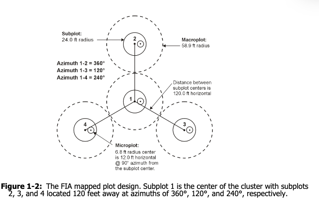
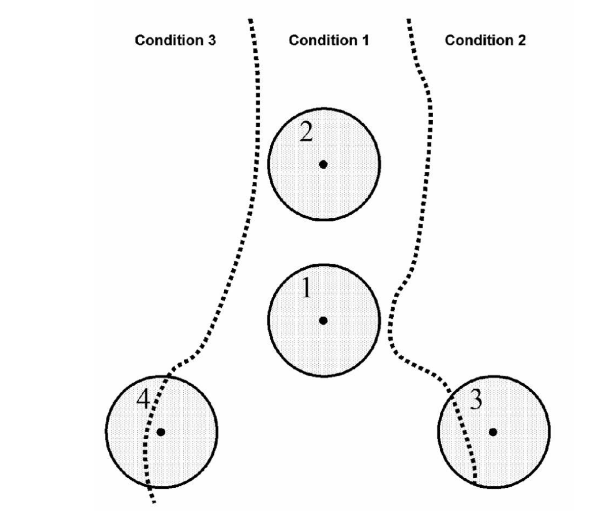

### Southeast Alaska Tree Carbon Stocks

This workflow filters Alaska plots in the US Forest Service Forest Inventory and Analysis database down to the North Pacific sub-region of the Coastal Temperate Rainforest biome to create a pre-processed and cleaned dataset of plot- and individual-tree level tree carbon estimates.  

#### The National Forest Inventory plot design, from the user guide
The FIA plot network is surveyed annually, but only around 10% of the plots in Alaska get surveyed each year, resulting in a 10-12 year lapse between remeasurements for any given plot.



**Figure 1.** Forest Inventory and Analysis Plot design. The standard plot (DESIGNCD = 1) consists of four subplots each with a 24-ft radius. In each plot, all trees 5 inches DBH or greater are measured. Each subplot contains a 6.8-ft radius microplot where seedlings under 5 in DBH are measured. In some Southeast Alaska plots, a slightly different design was used (DESIGNCD = 601, 602, & 603): 7.3 m radius subplots spaced 36.6 m apart, and 2.0 m radius microplots. From Burrill et al., (2004).



**Figure 2.** Schematic of FIA plot conditions. Plot land use, vegetation cover, stand density, and other attributes are described as conditions. Conditions do not necessarily align with plot boundaries, such that a single plot may contain multiple conditions. The share of the plot area in each condition is recorded as `CONDPROP_UNADJ` in the `COND` table. Each tree is assigned to the condition it occupies (`CONDID` in the `TREE` table). From Burrill et al., (2004).

#### FIA database structure
For tree carbon estimates, the database tables used are `COND` (.csv), `PLOT` (.csv), and `TREE` (.csv). The variables used in this workflow are described below; for detailed descriptions of all variables in each table, see the FIA User Guide (Burrill et al., 2024). 
### Data dictionaries: FIA tables

#### `COND` table (`condctr`)
Condition table.

```{r dd-cond, echo=FALSE}
dd_cond <- tibble::tribble(
  ~Variable, ~Description, ~Units_codes, 
  "PLOT", "Plot number (unique within state/unit/county)", "integer", 
  "CONDID", "Condition class number within the plot", "1-9", 
  "FORTYPCD", "Forest type, algorithm-assigned from tree stocking", "code (FIADB Appendix D)",
  "STDAGE", "Stand age (age of the stand, usually from tree ages of the dominant trees)", "years",
  "SICOND", "Site index for the condition", "feet at base age (SIBASE)", 
  "SLOPE", "Slope of the condition", "percent",
  "ASPECT", "Aspect of the condition", "degrees (0 or 361 = no aspect / flat)", 
  "PHYSCLCD", "Physiographic class (moisture/topographic setting)", "code (e.g. 11-19 xeric, 21-29 mesic, 31-39 hydric)", 
  "DSTRBCD1", "Disturbance code 1 (most significant disturbance since last visit or within ~5 yrs)", "code (e.g. 30=Fire, 50=Weather, 52=Wind)", 
  "DSTRBYR1", "Year of disturbance 1", "year", 
  "DSTRBCD2", "Disturbance code 2", "code", 
  "DSTRBYR2", "Year of disturbance 2", "year",
  "DSTRBCD3", "Disturbance code 3", "code",
  "DSTRBYR3", "Year of disturbance 3", "year", 
  "TRTCD1", "Stand treatment code 1 (human treatment)", "code (e.g. 10=Cutting, 20=Site prep, 30=Artificial regen)", 
  "TRTYR1", "Year of treatment 1", "year",
  "TRTCD2", "Stand treatment code 2", "code", 
  "TRTYR2", "Year of treatment 2", "year", 
  "TRTCD3", "Stand treatment code 3", "code",
  "TRTYR3", "Year of treatment 3", "year")
knitr::kable(dd_cond, col.names = c("Variable", "Description", "Units / codes"))
```

#### `PLOT` table (`plotctr`)
`PLOT` describes the entire plot, consisting of four subplots (with the exception of some older designs from early inventory periods which may have a different number of subplots).
Selected plot-level fields.

```{r dd-plot, echo=FALSE}
dd_plot <- tibble::tribble(
  ~Variable, ~Description, ~Units_codes,
  "INVYR", "Inventory year", "year",
  "PLOT", "Phase 2 plot number", "integer",
  "DESIGNCD", "Plot design code; lets you know if this plot-year combination adhered to the more recent 4 subplot design or an older design", "1=Standard national 4-subplot design; 601=older PNW design; others regional",
  "LAT", "Plot latitude (fuzzed, meaning assigned a different coordinate in a similar site to protect private land)", "decimal degrees, NAD83",
  "LON", "Plot longitude (fuzzed, meaning assigned a different coordinate in a similar site to protect private land)", "decimal degrees, NAD83",
  "ELEV", "Plot elevation above sea level", "feet",
  "MORT_TYP_CD", "If the tree died, code for type of mortality", "code",
  "WATERCD", "Metadata for if there is water on plot, like a stream or pond", "0=None, 1=Permanent stream/pond <1 ac, 2=Permanent water 1-4.9 ac, 3=Permanent water >=5 ac, 4=Ditch/canal, 5=Temporary water, 9=Other"
)

knitr::kable(dd_plot, col.names = c("Variable", "Description", "Units / codes"))
```

#### `TREE` table (`treectr`)
`TREE` contains tree-level measurements. Each tree is numbered and measured within the subplot, so each tree in the `TREE` table is uniquely identified by `TREE` within `SUBP` and `PLOT`.
Selected tree-level fields used for tree carbon, growth, and mortality estimates. Biomass fields are in pounds.

```{r dd-tree, echo=FALSE}
dd_tree <- tibble::tribble(
  ~Variable, ~Description, ~Units_codes,
  "INVYR", "Inventory year", "year",
  "PLOT", "Phase 2 plot number", "integer",
  "SUBP", "Subplot number (important because TREE is identified within the subplot)", "1-4",
  "TREE", "Unique tree ID within a subplot", "integer",
  "CONDID", "Condition class ID; matches CONDID in the COND table, allowing you to pair each tree with, e.g., the forest type it is within", "integer",
  "STATUSCD", "Status code - dead or alive", "0=No status, 1=Live, 2=Dead, 3=Removed",
  "SPCD", "Species code", "code (REF_SPECIES)",
  "DIA", "Diameter at breast height (dbh)", "inches",
  "ACTUALHT", "Actual tree height", "feet",
  "HT", "Estimated height; in the case of a broken top, this is what the worker estimates the height was before the break. For unbroken trees, actual = estimated", "feet",
  "DECAYCD", "Snag decay class", "1 (least decayed) to 5 (most decayed)",
  "DAMTYP1", "Damage type code 1", "code",
  "DAMTYP2", "Damage type code 2", "code",
  "PREVDIA", "Previous inventory diameter; can be used to check for suspicious DBH measurements", "inches",
  "MORTYR", "Estimated year of death", "year",
  "DAMAGE_AGENT_CD1", "Cause of damage code 1", "code",
  "DAMAGE_AGENT_CD2", "Cause of damage code 2", "code",
  "DAMAGE_AGENT_CD3", "Cause of damage code 3", "code",
  "DRYBIO_AG", "Estimated total aboveground biomass using FIA component ratio calculations", "pounds (oven-dry)",
  "DRYBIO_STEM", "Full tapered stem estimated biomass from the FIA component ratio method (CRM)", "pounds (oven-dry)",
  "DRYBIO_STEM_BARK", "CRM estimates of stem + bark", "pounds (oven-dry)",
  "DRYBIO_BRANCH", "CRM estimated branch biomass", "pounds (oven-dry)",
  "PREV_ACTUALHT_FLD", "Previous field actual height measurement; used to check for suspicious height measurements", "feet",
  "PREV_HT_FLD", "Previous field total height measurement; used to check for suspicious height measurements", "feet"
)

knitr::kable(dd_tree, col.names = c("Variable", "Description", "Units / codes"))
```

#### FIA tree carbon estimates

Here I use FIA height and diameter measurements to estimate stem biomass (including standing dead) with the Kozak equation by species and by forest type (Kozak et al. 1969, Carter and Buma 2024).

#### Downloading FIA data
The zip file containing all FIA tables for Alaska was downloaded at the FIA data mart (https://research.fs.usda.gov/products/dataandtools/fia-datamart). Then, I used the `rFIA` package (https://doserlab.com/files/rfia/) to clip the files in the AK statewide zip folder into my extent of interest - in this case, I used a shape file of the coastal temperate rainforest extent from Data Basin by the Conservation Biology Institute (https://databasin.org/datasets/9bb9859d08bb49e1890b953199507b0c/).

```{r setup, include=FALSE}
knitr::opts_chunk$set(echo = TRUE)
setwd("/Users/browncreeper/Library/CloudStorage/Box-Box/Projects/Yellow Cedar/Datasets/Yellow-cedar-data-compilation/FIA") #macbook
#setwd("C:/Users/jgmur/Box/Projects/Yellow Cedar/Datasets/Yellow-cedar-data-compilation") #surface
```

```{r message=FALSE, include=FALSE}
suppressPackageStartupMessages(library(tidyverse))
suppressPackageStartupMessages(library(sf))
suppressPackageStartupMessages(library(rFIA))
```

`readFIA()` reads in the Alaska FIA database (a directory, `AK_CSV`) and `st_read()` reads in the shape file of the coastal temperate rainforest (`ctr`). The clipping step, `clipFIA()`, takes a WHILE. Once you clip it, save your database with `saveRDS()` (here as `FIAdb_clippedtoCTR.rds`) so that next time you work with it, you can read it in with `readRDS()` instead of clipping again.

```{r}
ctr <- st_read("ctrf")

# ak <- readFIA("AK_CSV")
# ak_ctr_db <- clipFIA(ak, mask=ctr, mostRecent = FALSE)
# saveRDS(ak_ctr_db, file = "AKdb_clippedtoCTR.rds")
ak_ctr_db <- readRDS("AKdb_clippedtoCTR.rds")
```

The tree species list for FIA (`treespecies`) is used to convert `SPCD` to scientific and common names. In the FIA tables the species code is called `SPCD`, so `FIA.Code` is renamed to match.

```{r bring in FIA database & tree metadata, warning=FALSE, message=FALSE}
treespecies <- read.csv("v9-5_2024-10_Natl_MasterTreeSpeciesList.csv")

treespecies <- treespecies %>% 
  select(FIA.Code, Common.Name, SCIENTIFIC_NAME) %>%
  rename(SPCD = FIA.Code)
```

Get the tables and variables of interest from `ctr_db`. Species names are joined by `SPCD`, and plot coordinates are joined from `PLOT` and converted to an `sf` object, `treesf`, for mapping.

```{r get tree table, warning=FALSE, message=FALSE}
treectr <- ak_ctr_db$TREE

trees <- treectr %>% select(INVYR, PLOT, SUBP, TREE, CONDID, STATUSCD, MORTYR, DECAYCD, SPCD, DIA, HT, ACTUALHT, TPA_UNADJ, DRYBIO_STEM)
trees <- trees %>% left_join(treespecies)

plots <- ak_ctr_db$PLOT
plots <- plots %>% select(INVYR, PLOT, LAT, LON)
trees <- trees %>% left_join(plots)
treesf <- st_as_sf(trees, coords = c("LON", "LAT"))
st_crs(treesf) ="EPSG:4326"

```

Bring in condition information (`condctr`, the `COND` table, which contains information like `FORTYPCD`) and merge in forest types. Forest type names are assigned from the `FORTYPCD` code using `foresttypecodes` (FIA Appendix D).

```{r}
condctr <- ak_ctr_db$COND

cond <- condctr %>%  select(INVYR, PLOT, CONDID, FORTYPCD, CONDPROP_UNADJ)
trees <- trees %>% left_join(cond, by = c("INVYR", "PLOT", "CONDID"))


foresttypecodes <- read.csv("FIAappendixD_foresttypecodes.csv")
trees <- trees %>% left_join(foresttypecodes)

```

## Database summary

### Number of plots in database
```{r}
trees %>%
  summarise(n_plots = n_distinct(PLOT))

```

### Number of plots that contain a given forest type
```{r}
trees %>%
  group_by(foresttype) %>%
  summarise(n_plots = n_distinct(PLOT))
```
### Number of plots that contain a given tree species
```{r}
trees %>%
  group_by(Common.Name) %>%
  summarise(n_plots = n_distinct(PLOT))
```

## Map: Coastal temperate rainforest boundary
```{r}
ggplot() + 
  geom_sf(data=ctr) 

```

## Map of all AK FIA plots within the CTR shape
```{r, echo=FALSE}
ggplot() + 
  geom_sf(data=ctr) + 
  geom_sf(data=treesf, color="darkgreen", shape=21, fill=NA, size=1, stroke=0.5) +
  theme_minimal()
```

## Calculate biomass estimates with Kozak integration
### Prep data for calculations

**Note about height values in FIA:** within the FIA documentation, if an `ACTUALHT` value is not present it is because the `HT` value is the true height. If there is an `ACTUALHT` value (and it is less than the `HT` value), that means the tree is broken. So where `ACTUALHT` is blank, it is filled with `HT`. Rows with no `DIA` (no DBH observation) are removed.

**Unit conversions:** `DIA` (in) is converted to `DBH_cm`, and `HT`/`ACTUALHT` (ft) are converted to `HT_m` and `ACTUALHT_m`. Cases where `HT_m` is less than `ACTUALHT_m` are erroneous and are dropped. Imperial-unit columns (`DBH.in`, `Ht.act.ft`, `HT.ft`) are retained for the Kozak equation. The commented-out lines are a leftover option for setting a minimum DBH for calculations (subsetting saplings, `DBH` < 5, for later recruitment calcs).

**Kozak et al. 1969 taper equation** (for estimating stem biomass): it can account for broken trees using the `ACTUALHT` values, where `d` is the diameter (in) at the broken height (ft), `h` is the height of break (ft), `D` is the dbh (in), and `H` is the model height. `a`, `b`, and `c` are species-specific constants, brought in from `kozak_constants.csv` for species common in YC stands. Rows with `NA` for any of the needed columns are removed.

#NOTE this code chunk was created by Trevor Carter, how do I attribute him / ask his permission for me to use this?

#also here is a resource from BC on using Kozak's tapering equation
```{r prep for calculations,warning=FALSE, message=FALSE}

trees$ACTUALHT <- ifelse(is.na(trees$ACTUALHT), trees$HT, trees$ACTUALHT)

trees <- trees[!is.na(trees$DIA),]

# # set minimum dbh for calculations
# saplings <- trees %>% filter(DBH <5)
# trees <- trees %>% filter(DBH <5)

trees$DBH_cm <- trees$DIA*2.54
trees$HT_m <- trees$HT/3.281 
trees$ACTUALHT_m <- trees$ACTUALHT/3.281 
trees <- trees[trees$HT_m >= trees$ACTUALHT_m,]

trees$DBH.in <- trees$DIA
trees$Ht.act.ft <- trees$ACTUALHT
trees$HT.ft <- trees$HT

area_kozak_m2 <- function(h, D, H, a, b, c) {
  d <- D * sqrt(b*((h/H)-1) + c*(((h^2)/(H^2))-1))
  d_ft <- d/12
  r_ft <- d_ft/2
  a_ft2 <- (r_ft^2)*3.14
  a_m2 <- a_ft2/10.764
  return(a_m2)
} ## EQ 4 in Kozak 1969

integrate_area_kozak <- function(h_ft, dbh_in, H_ft, a, b, c) {
  storage <- integrate(area_kozak_m2,
                       lower = 0,
                       upper=h_ft,
                       D=dbh_in,
                       H=H_ft,
                       a=a,
                       b=b,
                       c=c)
  return(tryCatch(storage[[1]], error = function(e) NA))
}

constants <- read.csv("kozak_constants.csv")
trees$a <- constants$a[match(trees$Common.Name, constants$Common.Name)] 
trees$b <- constants$b[match(trees$Common.Name, constants$Common.Name)]
trees$c <- constants$c[match(trees$Common.Name, constants$Common.Name)]

trees <- trees %>% drop_na(c(Ht.act.ft, DBH.in, HT.ft, a, b, c))
```

### Calculate plot areas

Plot area is determined from the plot design, which is a little complicated because there are a few different plot designs and also varying numbers of subplots that were actually set up or measured within a plot.

- `DESIGNCD` corresponds to the plot set-up and is brought in from the `PLOT` table.
- Subplot area (`SubP.Area.m2`) is 167.4155 m^2^ for `DESIGNCD` 601, and 168.1134 m^2^ for `DESIGNCD` 1, 506, 602, and 603 (from FIA documentation). All YC plots have a sample design code of 1, for which subplot area is calculated as pi * 7.3152^2.
- A `for` loop determines the number of actual subplots in each plot-year (`PlotYear`); not all plots/years had all 4 subplots. The result is matched back to `trees` as `subP.Max`.
- `Plot.Area.ha` is the number of subplots multiplied by the subplot area, divided by 10000 (m^2^ to ha).

```{r Plot areas}
plots <- ak_ctr_db$PLOT
trees$DESIGNCD <- plots$DESIGNCD[match(trees$PLOT, plots$PLOT)]

trees$SubP.Area.m2 <- ifelse(trees$DESIGNCD == 601, 167.4155, 168.1134)

tmp <- trees
tmp$PlotYear <- paste(tmp$PLOT, tmp$INVYR, sep = "-")

plots <- unique(tmp$PlotYear)
vec <- FALSE
for(i in 1:length(plots)){
  t <- tmp[tmp$PlotYear == plots[i],]
  vec <- append(vec,max(t$SubP))
}
table(vec)

vec <- vec[2:length(vec)] 
tmp <- data.frame(plot = plots, subP.Max = vec)
trees$Plot_Yr <- paste(trees$PLOT, trees$INVYR, sep = "-")

trees$subP.Max <- tmp$subP.Max[match(trees$Plot_Yr, tmp$plot)]

trees$Plot.Area.ha <- trees$subP.Max*trees$SubP.Area.m2/10000 

```

### Kozak integration
**expand upon this section

The Kozak et al. 1969 equation is used to calculate the diameter (in) at the broken height, and then the cross-sectional area at the broken height, which is integrated from 0 to the height of break (`Ht.act.ft`). Here `d` is the diameter (in) at the broken height, `h` is the height of break, `D` is the dbh (in), and `H` is the model height (`HT.ft`, the predicted height if unbroken). `a`, `b`, and `c` are species-specific constants. `area_kozak_ft2()` returns area in ft^2^ (this redefines the functions in the previous section, now using `pi` and keeping feet), and `integrate_area_kozak()` is the point-estimate version that returns volume in ft^3^, converted to m^3^ as `volume_kozak_m3`.

`Density.kg.m3` (specific wood density) comes from `constants$spg_kgm3`. Volume is converted to stem biomass (`stem_biomass.kg`), and then scaled to a per-hectare basis (`stem_biomass.kg.ha`) with `Plot.Area.ha`.

```{r Kozak integration, warning=FALSE, message=FALSE}
area_kozak_ft2 <- function(h, D, H, a, b, c) {
  d <- D * sqrt(b*((h/H)-1) + c*(((h^2)/(H^2))-1))
  d_ft <- d/12
  r_ft <- d_ft/2
  a_ft2 <- (r_ft^2)*pi
  return(a_ft2)
} ## EQ 4 in Kozak 1969

integrate_area_kozak <- function(h_ft, dbh_in, H_ft, a, b, c) {
  storage <- integrate(area_kozak_ft2,
                       lower = 0,
                       upper=h_ft,
                       D=dbh_in,
                       H=H_ft,
                       a=a,
                       b=b,
                       c=c)
  return(tryCatch(storage[[1]], error = function(e) NA))
}

 trees$volume_kozak_ft3 <- mapply(integrate_area_kozak, trees$Ht.act.ft, trees$DBH.in, trees$HT.ft, trees$a, trees$b, trees$c)

  trees$volume_kozak_m3 <- trees$volume_kozak_ft3 * 0.0283168

trees$Density.kg.m3 <- constants$spg_kgm3[match(trees$Common.Name, constants$Common.Name)]

trees$stem_biomass.kg <- trees$volume_kozak_m3*trees$Density.kg.m3

trees <- trees %>% mutate(stem_biomass.kg.ha = stem_biomass.kg/Plot.Area.ha)
```

#### Compare Kozak estimates with the FIA-provided, component ratio method estimates

`DRYBIO_STEM` (lb) is converted to kg as `cr_drybio_stem_kg` and plotted against the Kozak estimate `stem_biomass.kg`; the dashed line is 1:1.

Component ratio method citations: Woodall et al., 2011; Westfall et al., 2024.
```{r, echo=FALSE}

trees <- trees %>% mutate(cr_drybio_stem_kg = DRYBIO_STEM*0.454)
trees %>% 
  filter(Common.Name %in% c("Alaska yellow-cedar", "mountain hemlock", "lodgepole pine", "Sitka spruce", "western hemlock", "western redcedar")) %>% 
  ggplot(aes(x=cr_drybio_stem_kg, y = stem_biomass.kg, color = Common.Name))+
  geom_point(alpha=0.5) +
  geom_abline(slope = 1, linetype = "dashed") +
  ylab("Kozak stem biomass, kg") +
  xlab("CRM stem biomass, kg") +
  theme_minimal()

``` 

#### Basal area
```{r calculate basal area, warning=FALSE, message = FALSE}
trees <- trees %>% 
mutate(basalarea_m2= pi * (DBH_cm/100 / 2)^2,
       basalarea_m2.ha = basalarea_m2/Plot.Area.ha)
```

### Tree carbon

Carbon fractions come from two sources: `decaytable` (`Table S10b_fia_wood_c_frac_dead.csv`, from FIA), which gives the carbon fraction of dead wood by `woodtype` and `DECAYCD` (converted to `deadcarbonratio`), and `reftable` (`REF_SPECIES.CSV`), which gives `CARBON_RATIO_LIVE` for live trees. `woodtype` is "Hardwood" for red alder and "Softwood" otherwise. `AliveDead` is derived from `STATUSCD` (1 = live), and tree carbon is `stem_biomass.kg.ha` multiplied by the live or dead carbon ratio.

```{r}
decaytable <- read.csv("Table S10b_fia_wood_c_frac_dead.csv")
decaytable <- decaytable %>% 
  rename("woodtype" = "S.H",
         "DECAYCD" = "Decay.code")

decaytable <- decaytable %>% 
  mutate(deadcarbonratio = C.fraction/100)

reftable <- read.csv("REF_SPECIES.CSV")

reftable <- reftable %>% 
  rename("Common.Name" = "COMMON_NAME")

trees <- reftable %>% select(Common.Name, CARBON_RATIO_LIVE) %>% 
  right_join(trees, by= "Common.Name")

trees <- trees %>% 
  mutate(woodtype = if_else(Common.Name == "red alder", "Hardwood", "Softwood"))

trees <- trees %>% left_join(decaytable, by = c("DECAYCD", "woodtype"))

trees <- trees %>% 
  mutate(AliveDead = if_else(STATUSCD == 1, "live", "dead"))

trees <- trees %>% 
  mutate(tree_AGC_kg = case_when(AliveDead == "live" ~ stem_biomass.kg.ha * CARBON_RATIO_LIVE,
                                 AliveDead == "dead" ~ stem_biomass.kg.ha * deadcarbonratio),
         tree_AGC_kg_ha = case_when(AliveDead == "live" ~ stem_biomass.kg.ha * CARBON_RATIO_LIVE,
                                 AliveDead == "dead" ~ stem_biomass.kg.ha * deadcarbonratio))

```

#### Note on plot vs. condition vs. forest type

`FORTYPCD` (forest cover type) is assigned based on `CONDID`. A single plot can have multiple conditions and therefore multiple forest cover types within it. Some plots have up to 4 `FORTYPCD`; to estimate biomass or C on an area basis by forest cover type, we need to know what proportion of the plot is occupied by a given forest type. This proportion is found in the column `CONDPROP_UNADJ`.

A unique plot-condition code (`plotcondcd`) and plot-year code (`Plot_Yr`) are made, and the chunk below checks how many plots have multiple forest types within them (`plots_with_multiple_fortypcd`, `inspect_fortypcd_details`, `condid_counts`).

```{r Plot conditions, warning=FALSE, message=FALSE}

trees <- trees %>% 
  mutate(plotcondcd = paste(PLOT, CONDID, sep = "-"),
         Plot_Yr = paste(trees$PLOT, trees$INVYR, sep = "-"))
plots_with_multiple_fortypcd <- trees %>%
  group_by(Plot_Yr) %>% 
  summarise(n_fortypcd = n_distinct(FORTYPCD)) %>%
  filter(n_fortypcd > 1)

inspect_fortypcd_details <- trees %>%
  filter(Plot_Yr %in% plots_with_multiple_fortypcd$Plot_Yr) %>%
  arrange(Plot_Yr, CONDID, FORTYPCD)

condid_counts <- trees %>%
  group_by(Plot_Yr) %>% 
  summarise(n_condid = n_distinct(CONDID),
            n_ft = n_distinct(FORTYPCD),
            n_condprop = n_distinct(CONDPROP_UNADJ)) %>%
  arrange(desc(n_condid))
```

#### Growth, recruitment, and mortality rates

A unique tree ID (`uniquetreeid`) is created from `PLOT`, `SUBP`, and `TREE`. `broken_status` flags trees where `HT_m` > `ACTUALHT_m`. `recruitment_flag` marks trees whose previous DBH (`prev_dia`) was < 5 in and current `DBH.in` is >= 5 in. `design_change` flags a change in `DESIGNCD` from 601 to 1 between inventories.

```{r growth, recruitment, mortality rates, warning=FALSE, message=FALSE}
plotctr <-ak_ctr_db$PLOT
trees <- trees %>%
  left_join(
    plotctr %>% select(PLOT, DESIGNCD, INVYR),
    by = c("PLOT","INVYR")
  )

trees <- trees %>% 
  mutate(uniquetreeid = paste(PLOT, SUBP, TREE, sep="-"))

trees <- trees %>%
  arrange(uniquetreeid, INVYR) %>%
  group_by(uniquetreeid) %>%
  mutate(
    broken_status = case_when(HT_m > ACTUALHT_m ~ "broken",
                              HT_m == ACTUALHT_m ~ "intact"),
    prev_dia = lag(DBH.in),
    recruitment_flag = if_else(
      !is.na(prev_dia) & prev_dia < 5 & DBH.in >= 5,
      1L, 0L
    )
  ) %>%
  ungroup()


trees <- trees %>% select(-DESIGNCD.y)
trees <- trees %>% rename(DESIGNCD = DESIGNCD.x)
trees <- trees %>%
  group_by(uniquetreeid) %>%
  mutate(prev_DESIGNCD = lag(DESIGNCD),
         design_change = prev_DESIGNCD == 601 & DESIGNCD == 1) %>%
  ungroup()

```

**Step 1: per-tree growth and mortality (`tree_change`).** Broken trees are excluded. `foresttype` is deliberately NOT included in the grouping, since that classification sometimes changes between inventory years for the same tree; it is merged back later. Within each tree:

- `Lapse` is the number of years between inventories (`Year_start` to `Year_end`).
- `growth_kg_yr` is the absolute growth per tree (kg/year), calculated only where the tree was alive (`STATUSCD` == 1) at both inventories.
- `DBH_pct_change` and `Ht_pct_change` are percent changes in `DBH_cm` and `HT_m`, used to make sense of negative growth rates.
- `DBHshrink` classifies DBH shrinkage: changes >= -5% are "within_error_range" (FIA's own tolerance is +/- 10%, but DBH error tends to be smaller than that), and anything lower is "abnormal".
- `Htshrink` classifies height shrinkage: changes >= -10% are "within_error_range" (FIA's own tolerance is +/- 10%), and anything lower is "abnormal".
- `mortality_flag` is 1 when a tree was alive (`STATUSCD` 1) at the previous inventory and dead (`STATUSCD` 2) at the current one.
- `mortality_kg_yr` is the mortality rate (kg/year): the previous `stem_biomass.kg` divided by `Lapse` for trees that died, and 0 otherwise.
- `biomass_alive_start_kg` is the biomass alive at the start of the interval, and `biomass_lost_kg` is the biomass lost if the tree died.

Per-hectare rates `growth_kg_ha_yr` and `mortality_kg_ha_yr` are then calculated with `Plot.Area.ha`.

```{r}
tree_change <- trees %>%
  filter(broken_status !="broken") %>% 
  arrange(PLOT, Common.Name, uniquetreeid, SUBP, INVYR) %>%
  group_by(PLOT, Common.Name, uniquetreeid, SUBP) %>%
  mutate(
    Year_start = lag(INVYR),
    Year_end = INVYR,
    Lapse = INVYR - lag(INVYR),
    prev_stem_biomass.kg = lag(stem_biomass.kg),
    prev_Ht = lag(HT_m),
    growth_kg_yr = ifelse(STATUSCD == 1 & lag(STATUSCD) == 1,
                                (stem_biomass.kg - lag(stem_biomass.kg)) / Lapse,
                                NA_real_),
    DBH_pct_change = ((DBH_cm - lag(DBH_cm)) / lag(DBH_cm)*100),
    Ht_pct_change = ((HT_m - lag(HT_m))/lag(HT_m)*100),
    DBHshrink = case_when(
      is.na(DBH_pct_change) ~ NA_character_,
      DBH_pct_change >= -5 ~ "within_error_range",
      DBH_pct_change < -5 ~ "abnormal"),
   Htshrink = case_when(
      is.na(Ht_pct_change) ~ NA_character_,
      Ht_pct_change >= -10 ~ "within_error_range",
      Ht_pct_change < -10 ~ "abnormal"),
    mortality_flag = ifelse(lag(STATUSCD) == 1 & STATUSCD == 2, 1, 0),
    mortality_kg_yr = ifelse(
      is.na(lag(INVYR)),
      NA_real_,
      ifelse(mortality_flag == 1,
             lag(stem_biomass.kg) / Lapse,
             0)
    ),
    biomass_alive_start_kg = lag(stem_biomass.kg),
    biomass_lost_kg = ifelse(is.na(lag(INVYR)), NA_real_,
                             ifelse(
                               mortality_flag == 1, lag(stem_biomass.kg), 0))
   ) %>%  
  ungroup()

tree_change <-tree_change %>% 
  mutate(growth_kg_ha_yr = growth_kg_yr/Plot.Area.ha,
         mortality_kg_ha_yr = mortality_kg_yr/Plot.Area.ha)
```

**Cleaning negative growth.** `neg_growth` collects trees with negative `growth_kg_ha_yr` for inspection. Trees with an "abnormal" `DBHshrink` or `Htshrink` are then removed from `tree_change`, and any remaining negative `growth_kg_ha_yr` is set to 0. Growth and mortality are converted to carbon (`growth_kgC_yr`, `growth_kgC_ha_yr`, `mortality_kgC_yr`, `mortality_kgC_ha_yr`) using `CARBON_RATIO_LIVE`, and `tree_change` is joined back onto `trees`.

```{r}
neg_growth <- tree_change %>% filter(growth_kg_ha_yr < 0)
neg_growth <- neg_growth %>% select(PLOT, INVYR, TREE, CONDID, MORTYR, DBH.in, prev_dia, HT_m, ACTUALHT_m,prev_Ht, stem_biomass.kg, prev_stem_biomass.kg,foresttype, Year_start, Year_end, Lapse, growth_kg_ha_yr,
                                    DBH_pct_change, DBHshrink)
tree_change %>%
  count(DBHshrink == "abnormal")
tree_change %>%
  count(Htshrink == "abnormal")

tree_change <- tree_change %>%
  filter(is.na(DBHshrink) | DBHshrink != "abnormal",
         is.na(Htshrink) | Htshrink != "abnormal")

tree_change <- tree_change %>% 
  mutate(growth_kg_ha_yr = if_else(growth_kg_ha_yr <0, 0, growth_kg_ha_yr))

tree_change <- tree_change %>% 
  mutate(growth_kgC_yr = growth_kg_yr*CARBON_RATIO_LIVE,
         growth_kgC_ha_yr = growth_kg_ha_yr*CARBON_RATIO_LIVE,
         mortality_kgC_ha_yr = mortality_kg_ha_yr*CARBON_RATIO_LIVE,
         mortality_kgC_yr = mortality_kg_yr *CARBON_RATIO_LIVE)

trees <- trees %>% left_join(tree_change)

```

### Sum biomass for each tree species within each condition

Three summaries are built in the chunk below:

- `tpa_manual`: manual trees-per-hectare calculation (`n_trees_ha`) from distinct trees per subplot (`subp_counts`), summed to plot-year-species and divided by `Plot.Area.ha`.
- `tpa`: trees per acre from `TPA_UNADJ`, converted to trees per hectare (`treesperha`).
- `rates`: growth, mortality, and recruitment summed independent of live/dead status, and rejoined after the live/dead summary. It uses `safe_sum()`, which returns `NA` when all values are `NA`, so that the first inventory year gets `NA` (rather than misleading zeroes) for growth/mortality/recruitment values. Rates are also expressed in Mg (`growthC_Mg_ha_yr`, `mortalityC_Mg_ha_yr`, `growthC_Mg_yr`, `mortalityC_Mg_yr`).

The `trees` table also gets biomass and carbon totals converted from kg to Mg (`AGBiomass.Mg`, `AGtreeC.Mg`, `AGBiomass.Mg.ha`, etc.).

```{r sum biomass, warning=FALSE, message=FALSE}

subp_counts <- trees %>%
  group_by(PLOT, SUBP, INVYR, Common.Name) %>%
  summarise(n_trees_subp = n_distinct(uniquetreeid), .groups = "drop")

tpa_manual <- subp_counts %>%
  group_by(PLOT, INVYR, Common.Name) %>%
  summarise(n_trees = sum(n_trees_subp), .groups = "drop")

tpa_manual <- tpa_manual %>%
  left_join(
    trees %>% distinct(PLOT, INVYR, Plot.Area.ha),
    by = c("PLOT", "INVYR")
  )
tpa_manual <- tpa_manual %>% 
  mutate(n_trees_ha = n_trees/Plot.Area.ha) %>%
  ungroup() 
  

tpa <- trees %>% 
  group_by(PLOT, CONDID, foresttype, Plot_Yr, INVYR, plotcondcd) %>% 
  summarize(treesperacre = sum(TPA_UNADJ),
            treesperha = treesperacre*2.47105)

safe_sum <- function(x) {
  if (all(is.na(x))) NA_real_ else sum(x, na.rm = TRUE)
}

rates <- trees %>%
  group_by(PLOT, CONDID, foresttype, Plot_Yr, INVYR, Common.Name, plotcondcd) %>%
  summarise(growth_kgC_yr = safe_sum(growth_kgC_yr),
            growth_kg_ha_yr = safe_sum(growth_kg_ha_yr),
            growth_kgC_ha_yr = safe_sum(growth_kgC_ha_yr),
            mortality_kgC_yr = safe_sum(mortality_kgC_yr),
            mortality_kg_ha_yr = safe_sum(mortality_kg_ha_yr),
            mortality_kgC_ha_yr = safe_sum(mortality_kgC_ha_yr))

rates <- rates %>% 
  mutate(growthC_Mg_ha_yr =growth_kgC_ha_yr/1000,
         mortalityC_Mg_ha_yr =mortality_kgC_ha_yr/1000,
         growthC_Mg_yr = growth_kgC_yr/1000,,
          mortalityC_Mg_yr =mortality_kgC_yr/1000)


trees <- trees %>% 
  mutate(AGBiomass.Mg = stem_biomass.kg/1000,
         AGtreeC.Mg = tree_AGC_kg/1000,
         AGBiomass.Mg.ha = stem_biomass.kg.ha/1000,
         Basalarea.m2.ha = basalarea_m2.ha,
         AGtreeC.Mg.ha = tree_AGC_kg/1000,
         growthC_Mg_yr = growth_kgC_yr/1000,
         growthC_Mg_ha_yr =growth_kgC_ha_yr/1000,
         mortalityC_Mg_yr =mortality_kgC_yr/1000,
         mortalityC_Mg_ha_yr =mortality_kgC_ha_yr/1000)
```

Biomass, basal area, and carbon are summed (`plotbiomass`) for trees with `DBH.in` > 5, grouped by status (`STATUSCD`, alive/dead) for later expansion into live vs. dead biomass. The table is then pivoted wide (`plotbiomass_wide`) so each `AliveDead` status has its own columns. The rates (`rates`) are added after the pivot because splitting mortality rates by dead/alive doesn't make sense, and `tpa_manual` is joined as well. Note that in some cases there are two conditions for a single forest type, so estimates need to be summed by plot and forest type.

```{r}
plotbiomass <- trees %>%
  filter(DBH.in > 5) %>% 
  group_by(PLOT, CONDID, foresttype, Plot_Yr, INVYR, STATUSCD, Common.Name, plotcondcd) %>%
  summarise(mean_DBHcm = mean(DBH_cm, na.rm=TRUE),
            sd_DBHcm = sd(DBH_cm, na.rm=TRUE),
            mean_htm = mean(HT_m, na.rm=TRUE),
            sd_htm = sd(HT_m, na.rm=TRUE),
            AGBiomass.kg = sum(stem_biomass.kg),
            AGBiomass.Mg = sum(AGBiomass.Mg),
            AGBiomass.kg.ha = sum(stem_biomass.kg.ha),
            AGBiomass.Mg.ha = sum(AGBiomass.Mg.ha),
            Basalarea.m2.ha = sum(Basalarea.m2.ha),
            AGtreeC.kg = sum(tree_AGC_kg),
            AGtreeC.Mg = sum(AGtreeC.Mg),
            AGtreeC.kg.ha = sum(tree_AGC_kg_ha),
            AGtreeC.Mg.ha = sum(AGtreeC.Mg.ha))


plotbiomass<- as.data.frame(plotbiomass) 

plotbiomass<- plotbiomass%>% 
  mutate(AliveDead = if_else(STATUSCD == 1, "live", "dead"))

plotbiomass<- plotbiomass%>%
  select(-c(STATUSCD))

plotbiomass_wide <- plotbiomass %>%
  pivot_wider(
    id_cols = c(PLOT, INVYR, Plot_Yr, Common.Name, CONDID, plotcondcd, foresttype),
    names_from = AliveDead,
    values_from = c(mean_DBHcm, sd_DBHcm, mean_htm, sd_htm, AGBiomass.Mg, AGBiomass.Mg.ha, Basalarea.m2.ha, AGtreeC.Mg, AGtreeC.Mg.ha),
    names_glue = "{.value}.{AliveDead}"
  )

plotbiomass_wide <- plotbiomass_wide %>% left_join(rates)
plotbiomass_wide <- plotbiomass_wide %>% left_join(tpa_manual)

```

#### Tree carbon stocks

Structural-zero `NA`s are converted to 0 in the plot-level live/dead summary columns (`carbon_stock_vars`). Here `NA` means "zero trees of this type", not "not measured". A sanity check confirms there are no more `NA`s in these columns. `ANPP_MgC_ha_yr` is `growthC_Mg_ha_yr` minus `mortalityC_Mg_ha_yr`, and `Totalbasalarea.m2.ha` is live plus dead basal area.

```{r}
carbon_stock_vars <- c(
  "AGBiomass.Mg.live",     "AGBiomass.Mg.dead",
  "AGBiomass.Mg.ha.live",  "AGBiomass.Mg.ha.dead",
  "Basalarea.m2.ha.live",  "Basalarea.m2.ha.dead",
  "AGtreeC.Mg.live",       "AGtreeC.Mg.dead",
  "AGtreeC.Mg.ha.live",    "AGtreeC.Mg.ha.dead"
)

plotbiomass_wide <- plotbiomass_wide %>%
  mutate(across(all_of(carbon_stock_vars), ~ replace_na(., 0)))

plotbiomass_wide %>%
  summarize(across(all_of(carbon_stock_vars), ~ sum(is.na(.))))

plotbiomass_wide <- plotbiomass_wide %>% 
  mutate(ANPP_MgC_ha_yr = growthC_Mg_ha_yr -mortalityC_Mg_ha_yr,
         Totalbasalarea.m2.ha = Basalarea.m2.ha.dead + Basalarea.m2.ha.live)
```

#### Convert to g/m^2^ (for Helene)

Carbon stocks and rates in Mg/ha are multiplied by 100 to get g/m^2^: `standingdead_C_gm2`, `AGtree_C_gm2`, `growthC_gm2_yr`, `mortalityC_gm2_yr`, and `ANPPC_gm2_yr`.

```{r convert to g/m2, warning=FALSE, message=FALSE}
plotbiomass_wide <- plotbiomass_wide %>% 
  mutate(standingdead_C_gm2 = AGtreeC.Mg.ha.dead*100,
         AGtree_C_gm2 = AGtreeC.Mg.ha.live*100,
         growthC_gm2_yr = growthC_Mg_ha_yr*100,
         mortalityC_gm2_yr= mortalityC_Mg_ha_yr*100,
         ANPPC_gm2_yr = ANPP_MgC_ha_yr*100)

```

#### Disturbance metadata

Conditions where logging or another treatment occurred (any non-zero `TRTCD1`-`TRTCD3`) are filtered out of `cond_dist`. Disturbance events that could be stand-replacing are flagged in `stand_repl_dist_flag` for later cleaning based on basal area (it has become clear that stand-replacing events have occurred even without any logging codes during the inventory period). `stand_repl_codes` are:

- 30, 32: fire
- 51, 52, 53: wind, flooding
- 91, 92, 93, 94, 95: geologic disturbances

```{r}
cond_dist <- condctr %>%
  filter(
    coalesce(TRTCD1, 0) == 0,
    coalesce(TRTCD2, 0) == 0,
    coalesce(TRTCD3, 0) == 0)
  
stand_repl_codes <- c(
  30, 32,
  51, 52, 53,
  91, 92, 93, 94, 95
)

cond_dist <- cond_dist %>%
  mutate(
    stand_repl_dist_flag = case_when(
      DSTRBCD1 %in% stand_repl_codes ~ DSTRBCD1,
      DSTRBCD2 %in% stand_repl_codes ~ DSTRBCD2,
      DSTRBCD3 %in% stand_repl_codes ~ DSTRBCD3,
      TRUE ~ NA_real_
    )
  )

cond_dist <- cond_dist %>%  select(INVYR, PLOT, CONDID, FORTYPCD, CONDPROP_UNADJ, stand_repl_dist_flag)

trees <- trees %>% left_join(cond_dist)
```

#### Filtering suspected unreported harvests

A lot of negative NPP and growth rates showed up, so records are further filtered based on suspected but unreported harvests:

- `BA_plotcond` is total basal area summed by plot-condition-year.
- `disturbflags` counts records where a natural stand-replacing disturbance could have happened.
- `shrink_flags` counts abnormal DBH shrinkage (`DBH_flag`) and broken trees (`broken_flag`) to see if those can explain negative NPP values.
- `plot_history` tracks the change in basal area (`ba_change`, `ba_pct_change`) between successive inventories for each plot-condition.
- `stand_replacement_status` classifies a loss of 70% or more in basal area as "Natural disturbance" if `disturbflags` is present, or "Possible unrecorded harvest" if not. Plot-conditions with a "Possible unrecorded harvest" (`stands_to_remove`) are removed from the full species-level dataset, `plotbiomass_wide`.

Results of the final checks: 11% of the plots have negative growth rates (`pct_negative`). There were 696 rows with negative growth rates; filtering to plots with reports of impossible DBH shrinkage or with broken trees gives only 164 rows, and after filtering for unrecorded harvest, 142.

```{r}
plotbiomass_wide <- plotbiomass_wide %>%
  group_by(PLOT, CONDID, INVYR) %>%
  mutate(
    BA_plotcond = sum(Totalbasalarea.m2.ha, na.rm = TRUE)
  ) %>%
  ungroup()

disturbflags <- trees %>%
  filter(stand_repl_dist_flag != 0) %>%
  group_by(PLOT, CONDID, foresttype, Plot_Yr, INVYR, Common.Name, plotcondcd) %>%
  summarise(disturbflags = n(), .groups = "drop")

shrink_flags <- trees %>%
  group_by(PLOT, CONDID, foresttype, Plot_Yr, INVYR, Common.Name, plotcondcd) %>%
  summarise(
    DBH_flag    = sum(DBHshrink == "abnormal", na.rm = TRUE),
    broken_flag = sum(broken_status == "broken", na.rm = TRUE),
    .groups = "drop"
  )

plotbiomass_wide <- plotbiomass_wide %>%
left_join(shrink_flags) %>%
  mutate(DBH_flag = ifelse(is.na(DBH_flag), 0, DBH_flag),
         broken_flag = ifelse(is.na(broken_flag), 0, broken_flag))

plotbiomass_wide <- plotbiomass_wide %>%
left_join(disturbflags)

plot_history <- plotbiomass_wide %>%
  distinct(
    PLOT,
    INVYR,
    .keep_all = TRUE
  )

plot_history <- plotbiomass_wide %>%
  distinct(PLOT, CONDID, INVYR, BA_plotcond, disturbflags) %>%
  arrange(PLOT, CONDID, INVYR) %>%
  group_by(PLOT, CONDID) %>%
  mutate(
    BA_prev = lag(BA_plotcond),
    ba_change = BA_plotcond - BA_prev,
    ba_pct_change = 100 * ba_change / BA_prev
  ) %>%
  ungroup()

plot_history %>%
  filter(ba_change < 0) %>%
  ggplot(aes(ba_pct_change)) +
  geom_histogram(binwidth = 5)

plot_history <- plot_history %>%
  mutate(
    stand_replacement_status = case_when(
      is.na(BA_prev) ~ NA_character_,

      !is.na(disturbflags) &
        ba_pct_change <= -70 ~ "Natural disturbance",

      is.na(disturbflags) &
        ba_pct_change <= -70 ~ "Possible unrecorded harvest",

      TRUE ~ "No major loss"
    )
  )

stands_to_remove <- plot_history %>%
  filter(stand_replacement_status == "Possible unrecorded harvest") %>%
  distinct(PLOT, CONDID)

plotbiomass_wide <- plotbiomass_wide %>%
  anti_join(stands_to_remove, by = c("PLOT", "CONDID"))

plotbiomass_wide %>%
     summarise(
         pct_negative = mean(growth_kgC_ha_yr < 0, na.rm = TRUE) * 100)

plotbiomass_wide %>%
    filter(growth_kgC_ha_yr < 0,
            DBH_flag >0,
            broken_flag >0
           ) %>% 
  summarise(count = n())

```

#### Output CSVs

Metadata from `condctr` (`STDAGE`, `SITECLCD`, `SICOND`, `SLOPE`, `ASPECT`, `PHYSCLCD`) and `plotctr` (`ELEV`, `WATERCD`) is joined to the tree-level table (`trees_final`). `elev_m` is `ELEV` converted from ft to m. Physiographic class and water-on-plot descriptions are joined from `physcodes` and `watercodes`.

```{r csvs, warning=FALSE, message=FALSE}
trees_final <- trees %>% left_join(
  condctr %>% select(PLOT, CONDID, INVYR, STDAGE, SITECLCD, SICOND, SLOPE, ASPECT, PHYSCLCD),
  by = c("PLOT", "CONDID","INVYR"))

trees_final <- trees_final %>% left_join(
  plotctr %>% select(PLOT, INVYR, ELEV, WATERCD),
  by = c("PLOT","INVYR"))

trees_final <- trees_final %>% mutate(elev_m = ELEV/3.281)

physcodes <- read.csv("FIA_2.5.35_physclcd_codes.csv")
physcodes <- physcodes %>% select(PHYSCLCD, phys_type, phys_cat)
trees_final <- trees_final %>% left_join(physcodes)

watercodes <- read.csv("FIA_8.2.19_WATERCD_codes.csv")
watercodes <- watercodes %>% select(WATERCD, wateronplot)
trees_final <- trees_final %>% left_join(watercodes)

```

```{r}
#write.csv(trees_final, "../treeC.csv")

```

The same metadata is added to the plot-level master data frame, `plotbiomass_final` (which also gets `LAT`, `LON`, and `DESIGNCD`). It is then ungrouped and written to a csv.

```{r do the same for allcarbon}
plotbiomass_final <- plotbiomass_wide %>% left_join(
  condctr %>% select(PLOT, CONDID, INVYR, STDAGE, SITECLCD, SICOND, SLOPE, ASPECT, PHYSCLCD),
  by = c("PLOT", "CONDID","INVYR"))

plotbiomass_final <- plotbiomass_final %>% left_join(
  plotctr %>% select(PLOT, INVYR, LAT, LON, ELEV, DESIGNCD, WATERCD),
  by = c("PLOT","INVYR"))

plotbiomass_final <- plotbiomass_final %>% mutate(elev_m = ELEV/3.281)

plotbiomass_final <- plotbiomass_final %>% left_join(physcodes)
plotbiomass_final <- plotbiomass_final %>% left_join(watercodes)

plotbiomass_final <- ungroup(plotbiomass_final)

#write.csv(plotbiomass_final, file = "../plotcarbon.csv")

```

#### Distributions of biomass, growth, mortality, and dead carbon

Density plots of log10-transformed values from `plotbiomass_final`, for the study species (`studyspp`) and forest types (`studyft`): live aboveground biomass by `foresttype`, `growthC_Mg_ha_yr`, `mortalityC_Mg_yr`, and standing dead carbon (`AGtreeC.Mg.ha.dead`), the last also faceted by `phys_cat`.

```{r echo=FALSE, error=FALSE, fig.height=6, fig.width=8, message=FALSE, warning=FALSE}
studyspp <- c("Alaska yellow-cedar", "Sitka spruce", "mountain hemlock","western hemlock","lodgepole pine","western redcedar")
studyft <- c( "Mountain hemlock", "Lodgepole pine", "Western hemlock","Alaska-yellow-cedar", "Western redcedar", "Sitka spruce")
plotbiomass_final %>% 
  filter(foresttype %in% studyft) %>% 
  ggplot(aes(x=log10(AGBiomass.Mg.ha.live), fill = foresttype, alpha=0.5)) +
  geom_density()+
  theme_minimal()
```
```{r echo=FALSE, error=FALSE, fig.height=6, fig.width=8, message=FALSE, warning=FALSE}
plotbiomass_final %>% 
  filter(Common.Name %in% studyspp) %>% 
  ggplot(aes(x=log10(growthC_Mg_ha_yr), fill = Common.Name, alpha=0.5)) +
  geom_density()+
  theme_minimal()
```


```{r echo=FALSE, error=FALSE, fig.height=6, fig.width=8, message=FALSE, warning=FALSE}
plotbiomass_final %>% 
  filter(Common.Name %in% studyspp) %>% 
  ggplot(aes(x=log10(mortalityC_Mg_yr), fill = Common.Name, alpha=0.5)) +
  geom_density()+
  theme_minimal()
```
```{r echo=FALSE, error=FALSE, fig.height=6, fig.width=8, message=FALSE, warning=FALSE}
plotbiomass_final %>% 
  filter(Common.Name %in% studyspp) %>% 
  ggplot(aes(x=log10(AGtreeC.Mg.ha.dead), fill = Common.Name, alpha=0.5)) +
  geom_density()+
  theme_minimal()
```

```{r echo=FALSE, error=FALSE, fig.height=6, fig.width=8, message=FALSE, warning=FALSE}
plotbiomass_final %>% 
  filter(Common.Name %in% studyspp) %>% 
  ggplot(aes(x=log10(AGtreeC.Mg.ha.dead), fill = Common.Name, alpha=0.5)) +
  geom_density() +
  facet_wrap(~phys_cat)+
  theme_minimal()
```

### References cited

Burrill, E. A., Christiansen, G., Conkling, B. L., DiTommaso, A. M., Lepine, L. C., Perry, C. J., ... & Walker, D. M. (2024). The Forest Inventory and Analysis Database User Guide.

Gray, A., Brandeis, T., Shaw, J. D., McWilliams, W., & Miles, P. D. (2012). Forest inventory and analysis database of the United States of America (FIA). In: Dengler, J.; Oldeland, J.; Jansen, F.; Chytry, M.; Ewald, J., Finckh, M.; Glockler, F.; Lopez-Gonzalez, G.; Peet, RK; Schaminee, J. HJ, eds. Vegetation databases for the 21st century. Biodiversity and Ecology. 4: 225-231., 225-231.

Kozak, A., Munro, D. D., & Smith, J. H. G. (1969). Taper functions and their application in forest inventory. The Forestry Chronicle, 45(4), 278-283.

Westfall, J. A., Coulston, J. W., Gray, A. N., Shaw, J. D., Radtke, P. J., Walker, D. M., ... & Domke, G. M. (2024). A national-scale tree volume, biomass, and carbon modeling system for the United States.

Woodall, C. W., Heath, L. S., Domke, G. M., & Nichols, M. C. (2011). Methods and equations for estimating aboveground volume, biomass, and carbon for trees in the US forest inventory, 2010. Gen. Tech. Rep. NRS-88. Newtown Square, PA: US Department of Agriculture, Forest Service, Northern Research Station. 30 p., 88, 1-30.